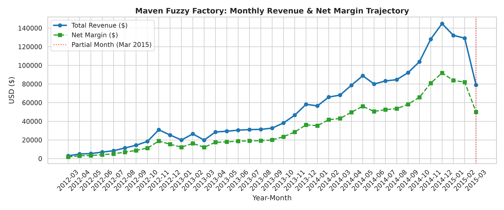
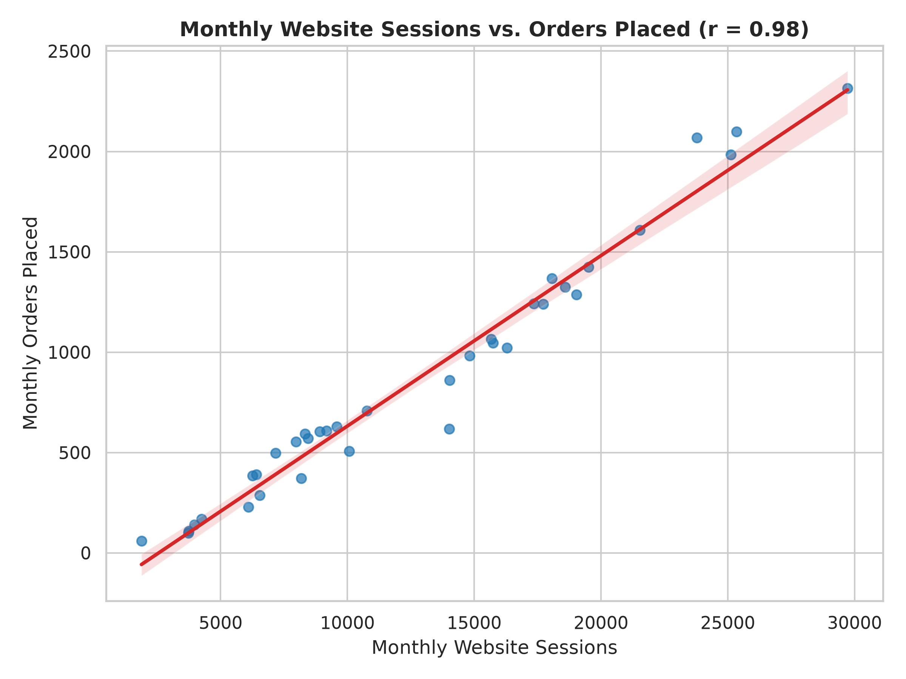
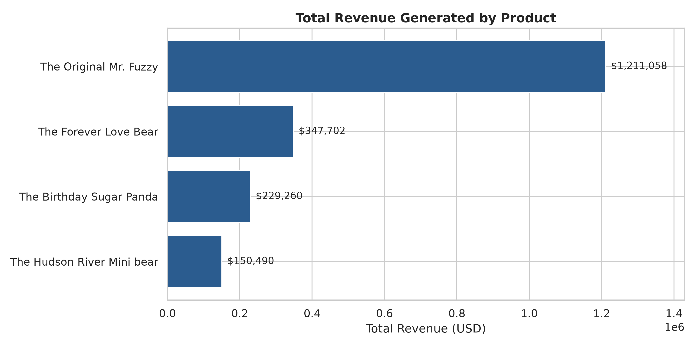
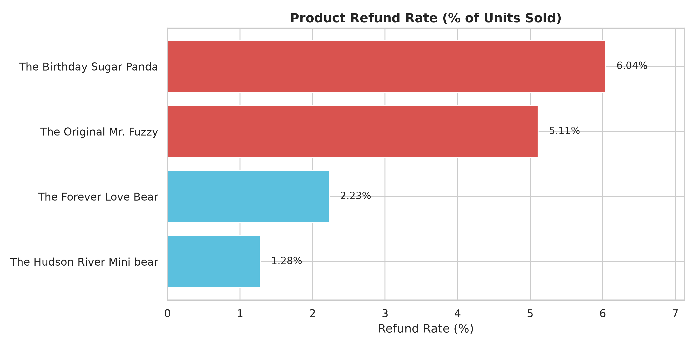
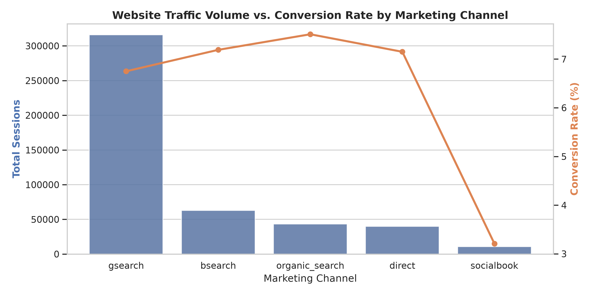
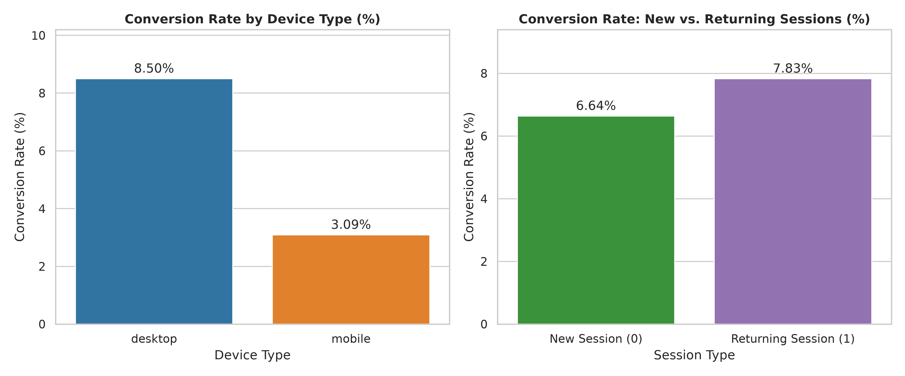

# Maven Fuzzy Factory — E-Commerce Business Performance & Customer Behaviour Analysis

[](https://www.python.org/)
[](https://pandas.pydata.org/)
[](https://scipy.org/)
[](#)

## Project Background & Business Objective
**Maven Fuzzy Factory** is an e-commerce retailer seeking to understand how its website performs, how customers interact with its product catalog, which marketing channels drive profitable sales, and where conversion bottlenecks occur.

Completed under **Track 2: Data Science** of the **AnalystLab Africa Experience Lab Internship**, this project conducts a full Exploratory Data Analysis (EDA) and statistical evaluation across six relational datasets spanning **March 2012 – March 2015** (**472,871 website sessions**, **1,048,575 pageviews**, **32,313 orders**, **40,025 sold items**, and **1,731 refunds**).

---

## Executive KPI Summary

| Metric | Value | Notes |
| :--- | :--- | :--- |
| **Total Website Sessions** | `472,871` | 394,318 new (83.39%) • 78,553 returning (16.61%) |
| **Total Website Pageviews** | `1,048,575` | ~2.22 average pageviews per session |
| **Total Orders Placed** | `32,313` | 6.83% overall session-to-order conversion rate |
| **Total Units Sold** | `40,025` | 76.13% single-item orders • 23.87% two-item orders |
| **Gross Revenue** | `$1,938,509.75` | Average Order Value (AOV): `$59.99` (Median: `$49.99`) |
| **Total COGS & Net Margin** | `$722,370.25` COGS | `$1,216,139.50` gross margin before refunds |
| **Total Refunds** | `1,731` items (`$85,338.69`) | `4.32%` overall item refund rate |
| **Traffic-to-Order Correlation** | `r = 0.9850` | Pearson $p = 1.64 \times 10^{-27}$ (full months) |

---

## Database Schema & Data Cleaning Methodology

### 1. Relational Schema Mapping
The six CSV tables form a star/funnel architecture centered on `website_sessions` and `orders_mav`:
* `website_sessions` (`website_session_id` PK) $\xrightarrow{1:M}$ `website_pageviews` (`website_session_id` FK)
* `website_sessions` (`website_session_id` PK) $\xrightarrow{1:1}$ `orders_mav` (`website_session_id` FK)
* `orders_mav` (`order_id` PK) $\xrightarrow{1:M}$ `order_items` (`order_id` FK)
* `products` (`product_id` PK) $\xrightarrow{1:M}$ `order_items` (`product_id` FK)
* `order_items` (`order_item_id` PK) $\xrightarrow{1:M}$ `order_item_refunds` (`order_item_id` FK)

### 2. Data Quality Audit & Feature Engineering
* **Duplicate Check:** Verified **0 exact duplicate rows** across all six datasets.
* **Preserving Null-UTM Sessions:** In `website_sessions`, **83,328 rows** had `NaN` values in `utm_source`, `utm_campaign`, and `utm_content`, while **39,917 rows** had `NaN` in `http_referer`. Rather than dropping 17.6% of total traffic, `http_referer` was used to classify non-paid traffic into **`organic_search` (43,411 sessions)** and **`direct` type-in traffic (39,917 sessions)**.
* **Datetime & Partial-Month Handling:** Converted all `created_at` columns to `datetime` and flagged **`2015-03`** (`1,254` orders; `$78,951.07`) as a partial final month so it does not distort time-series regression models.

---

## Detailed Analytical Findings (EDA & Statistical Tests)

### 1. Revenue Trajectory & Year-over-Year Growth
* Full-year orders more than doubled (**+126.4%**) from **2013** (`7,447` orders; `$393,247.87` revenue; `$52.81` AOV) to **2014** (`16,860` orders; `$1,075,612.19` revenue; `$63.80` AOV).
* Monthly revenue scaled from `$2,999.40` at launch (`2012-03`) to a peak of `$144,823.02` in `2014-12` (`2,314` orders; `$91,857.00` net margin).
* Across all complete months, monthly website sessions and completed orders exhibit a near-perfect linear relationship (**Pearson $r = 0.9850$, $p = 1.64 \times 10^{-27}$**).

### 2. Product Performance & Refund Breakdown

| Product Name | Units Sold | Gross Revenue | Revenue Share | Net Margin | Refunds | Refund Value | Refund Rate |
| :--- | :---: | :---: | :---: | :---: | :---: | :---: | :---: |
| **The Original Mr. Fuzzy** | 24,226 | $1,211,057.74 | 62.47% | $738,893.00 | 1,237 | $61,837.63 | 5.11% |
| **The Forever Love Bear** | 5,796 | $347,702.04 | 17.94% | $217,350.00 | 129 | $7,738.71 | 2.23% |
| **The Birthday Sugar Panda** | 4,985 | $229,260.15 | 11.83% | $157,027.50 | 301 | $13,842.99 | **6.04%** |
| **The Hudson River Mini bear** | 5,018 | $150,489.82 | 7.76% | $102,869.00 | 64 | $1,919.36 | **1.28%** |

### 3. Marketing Channels, Device Split & Visitor Retention

| Segment | Sessions | Session Share | Orders | Conversion Rate | Gross Revenue |
| :--- | :---: | :---: | :---: | :---: | :---: |
| **Channel: `gsearch`** | 316,035 | 66.83% | 21,333 | 6.75% | $1,276,144.89 |
| **Channel: `bsearch`** | 62,823 | 13.29% | 4,519 | 7.19% | $268,672.50 |
| **Channel: `organic_search`** | 43,411 | 9.18% | 3,262 | **7.51%** | $196,809.19 |
| **Channel: `direct`** | 39,917 | 8.44% | 2,856 | 7.15% | $174,623.84 |
| **Channel: `socialbook`** | 10,685 | 2.26% | 343 | **3.21%** | $22,259.33 |
| **Device: Desktop** | 327,027 | 69.16% | 27,805 | **8.50%** | $1,665,757.84 |
| **Device: Mobile** | 145,844 | 30.84% | 4,508 | **3.09%** | $272,751.91 |
| **Visitor: New (`0`)** | 394,318 | 83.39% | 26,164 | 6.64% | $1,566,274.92 |
| **Visitor: Returning (`1`)** | 78,553 | 16.61% | 6,149 | **7.83%** | $372,234.83 |

---

## Visualisations

| Monthly Revenue & Net Margin | Sessions vs. Orders Regression |
| :---: | :---: |
|  |  |

| Product Revenue Breakdown | Product Refund Rates |
| :---: | :---: |
|  |  |

| Marketing Channel Performance | Device & Repeat Conversion |
| :---: | :---: |
|  |  |

---

## Strategic Business Recommendations
1. **Close the Mobile Checkout Conversion Gap:** Desktop converts at **8.50%** vs. **3.09%** on mobile across `145,844` mobile sessions. Optimizing mobile page speed, form fields, and express mobile wallets to raise conversion from `3.09%` to `5.0%` would yield ~`2,785` incremental orders (~`$167,000` in additional revenue).
2. **Audit High-Refund SKUs:** *The Birthday Sugar Panda* (`6.04%` refund rate) and *The Original Mr. Fuzzy* (`5.11%`) account for **88.8% (`1,538` of `1,731`)** of all returned items. Inspect supplier quality control and align product descriptions/photos to reduce expectation-driven returns.
3. **Scale Checkout Cross-Sell Bundles:** Because **76.13%** of orders contain a single item, introducing automated checkout bundles pairing *The Original Mr. Fuzzy* with low-refund add-ons like *The Hudson River Mini bear* (`1.28%` refund rate) can lift multi-item order share and AOV.
4. **Reallocate `socialbook` Spend & Invest in SEO:** `socialbook` converts at just **3.21%**, whereas `organic_search` leads all channels at **7.51%**. Shift underperforming social ad spend into organic SEO content and high-intent `bsearch`/`gsearch` terms.
5. **Convert First-Time Buyers into Repeat Visitors:** Returning sessions convert **1.19 percentage points higher** than new sessions (`7.83%` vs. `6.64%`). Deploy automated post-purchase email flows and loyalty incentives 14–30 days after initial delivery.
6. **Standardize Q4 Inventory & Partial-Month Reporting:** Pre-scale inventory and paid search bids ahead of November–December holiday surges, and evaluate partial months using daily run-rates.

---

## Repository Structure
```text
├── week_two.ipynb                      # Complete Jupyter Notebook (Data Cleaning, EDA, Stats, Charts)
├── week_two.py                         # Exported Python source script
├── Maven_Fuzzy_Factory_EDA_Report.pdf  # Final executive EDA report (PDF)
├── Visualisations/                     # 6 high-resolution (300 DPI) PNG charts
│   ├── 01_monthly_revenue_trend.png
│   ├── 02_sessions_vs_orders_regression.png
│   ├── 03_product_revenue.png
│   ├── 04_product_refund_rates.png
│   ├── 05_marketing_channel_performance.png
│   └── 06_device_and_repeat_conversion.png
├── .gitignore                          # Excludes raw CSVs and large video recordings
└── README.md                           # Project documentation